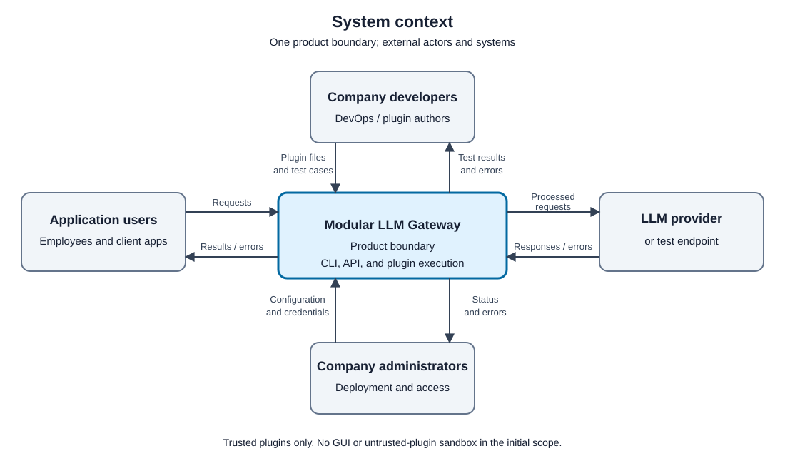

# Architecture

This architecture serves the scope defined in [Product Vision](../product-vision.md).

## Drivers

- **Threshold of Success:** [TOS-01 … TOS-nn](../threshold-of-success.md)
- **Constraints:** [## Constraints](../product-vision.md#constraints)
- **Functional requirements:** [Functional Requirements Index](../functional-requirements/README.md)
- **Quality requirements:** [Quality Requirements Index](../quality-requirements/README.md)

## Container View

The system runs as three deployable applications and one data store, and calls external LLM providers.

The stack and the split are decided in [ADR-001](adr/ADR-001.md).

### Container Responsibilities

| Container | Technology | Responsibilities | Data / State Owned |
| --- | --- | --- | --- |
| CLI | Python | Provides a command-line interface for developers and DevOps engineers; sends requests to the Gateway over HTTP; displays responses and errors | None (stateless client) |
| Gateway | Java | Receives client requests via custom HTTP API; coordinates request processing through the Plugin Manager; routes requests to LLM providers; applies configurable policies | In-memory request context; no persistent state |
| Plugin Manager | Python | Discovers and executes plugins; inspects and processes requests and responses; returns results to the Gateway | Loaded plugin registry (in memory) |
| Plugin Store | File system (local directory) | Stores plugin files uploaded via the CLI; persists plugin source between restarts | Plugin files and metadata |

### External Systems

| System | Interaction |
| --- | --- |
| LLM Providers (OpenAI-compatible APIs) | Gateway routes requests and receives completions over HTTPS |
| CLI users (developers / DevOps) | Send commands and plugin files to the Gateway |

## Architectural Decisions

| ID | Title | Status | Addresses |
| --- | --- | --- | --- |
| [ADR-001](adr/ADR-001.md) | Split into CLI, Gateway, and Plugin Manager with a Java/Python stack and a shared plugin volume | Accepted | FR-01…FR-07, QR-01, QR-02 |
| [ADR-002](adr/ADR-002.md) | Apply plugin changes by restarting the Plugin Manager, reading files from the shared volume | Accepted | FR-01, FR-02, FR-06, QR-02, QR-03 |
| [ADR-003](adr/ADR-003.md) | Expose plugin management as a Gateway HTTP API consumed by a thin CLI | Accepted | FR-01…FR-05, QR-01, QR-03 |

## Diagrams And Legends

**Legend:**

- Rectangle = application container
- Cylinder = data store
- Dashed rectangle = external system
- Solid arrow = synchronous HTTP call; label states what crosses it

**Tool:** PlantUML (C4-PlantUML)

**Sources:**

- Diagram image: `docs/architecture/container.svg`
- Diagram source: `docs/architecture/container.puml`
